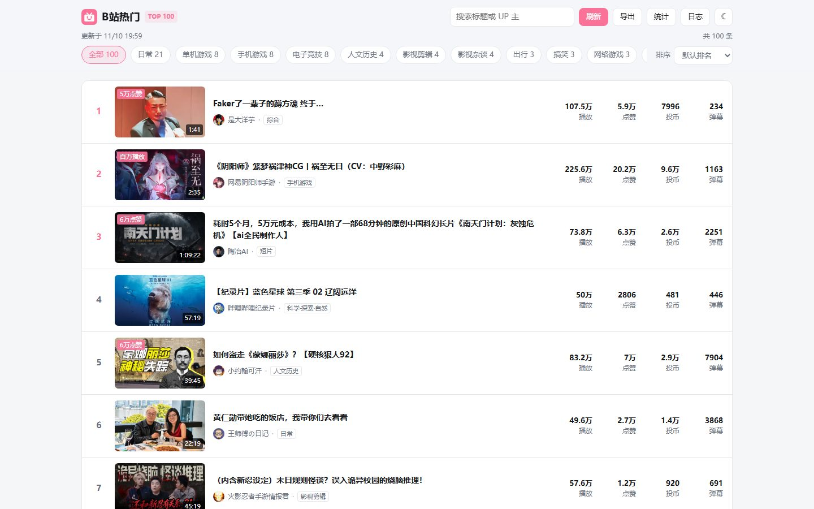
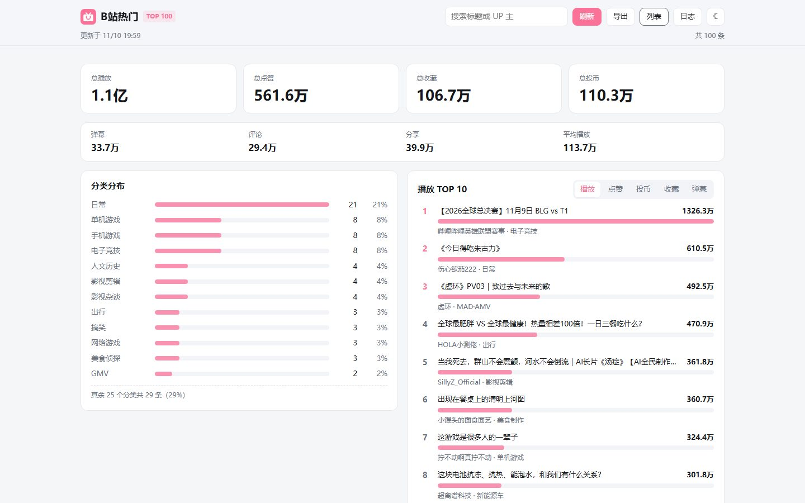

# B站热门视频 TOP 100

本地看板：抓 B站综合热门榜 100 条，按分类、播放、点赞浏览；封面和头像缓存在本地，断网也能看上一次的数据。





## 运行

Windows 双击 `start.bat`，或者在仓库根目录：

```bash
python run.py
```

首次运行会创建 `.venv`、安装后端依赖、构建前端，然后打开 http://127.0.0.1:8000 。需要 Python 3.11+ 和 Node.js 22.12+；之后启动只做增量检查。

```bash
python run.py --port 8010          # 换端口
python run.py --no-browser         # 不自动开浏览器
python run.py --rebuild            # 强制重建前端
python run.py --data-dir D:\bili   # 换数据目录
```

## 数据

- `data/snapshot.json` 是最后一次成功抓取。启动时先加载它，页面立刻可用，再决定是否刷新。
- `data/images/` 是封面和头像的缩略图，按图片地址的 md5 命名，196 张约 2 MB。
- 数据超过 5 分钟后打开页面，会在后台刷新一次；也可以点“刷新”手动抓。抓取过程在“日志”面板里。
- 顶部“导出”下载当前数据的 JSON，图片保留 B站原始地址。
- 只监听 `127.0.0.1`，不对外网开放。

## 开发

后端：

```bash
.venv\Scripts\python -m unittest discover -s server/tests -t .
.venv\Scripts\python -m ruff check .
.venv\Scripts\python -m ruff format --check .
```

前端（另开终端）：

```bash
cd web
npm run dev          # http://127.0.0.1:3000，/api 与 /img 代理到 8000
npm run typecheck
npm run test
npx playwright install chromium   # 首次跑 E2E 前装一次浏览器
npm run e2e
```

E2E 用离线夹具，不访问 B站：

```powershell
python server/tests/make_fixture.py data-e2e/snapshot.json
$env:BILIBILI_DATA_DIR="data-e2e"; $env:BILIBILI_PRELOAD="0"
python run.py --no-browser
cd web; npm run e2e
```

WSL / Linux 把 `.venv\Scripts\python` 换成 `.venv/bin/python`，其余相同。

## 结构

```
server/   FastAPI：抓取、缩略图、快照、日志、静态托管
web/      Vue 3 + TypeScript + Vite
run.py    启动入口
data/     运行时数据（不提交）
```

## 说明

- 数据来自 B站公开热门接口，抓 2 页 × 50 条；少于 90 条判为失败，保留旧数据。
- 前端运行时只有 Vue 一个依赖，明暗主题用 CSS 变量。
- 没有 CI，本地命令全部跑通再提交。
